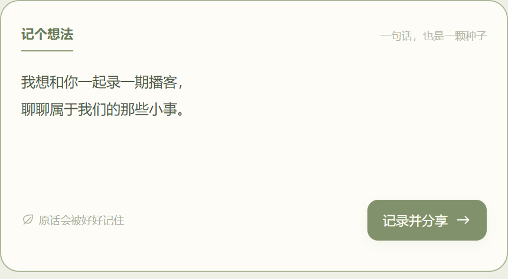
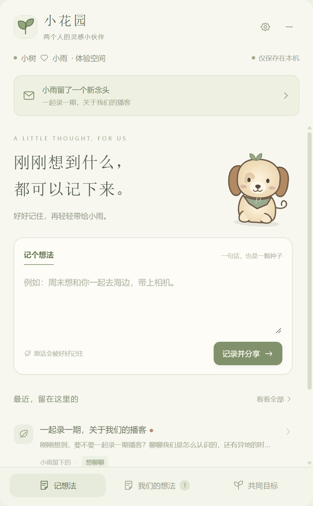
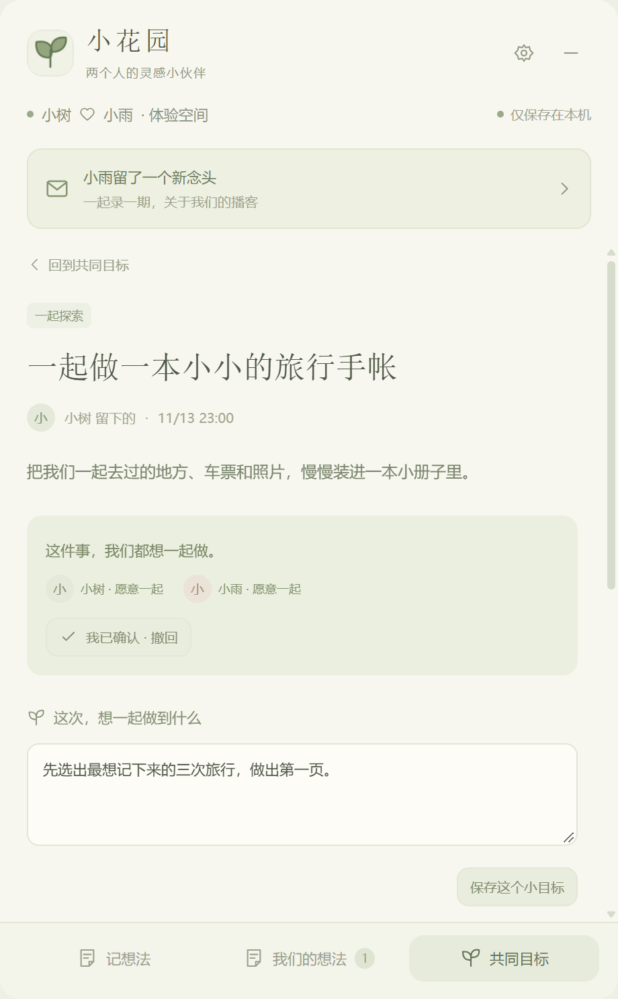
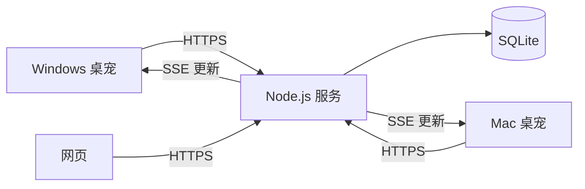

<p align="center"></p>

<h1 align="center">Our Garden · 小花园</h1>

<p align="center">桌面上一只小伙伴，替两个人记住想法。</p>

<p align="center">情侣桌宠 · 共享想法 · 共同目标</p>

<p align="center">
  <a href="https://github.com/Xiaoshu0553/our-garden/actions/workflows/ci.yml"></a>
  
  
</p>

<p align="center">
  <a href="https://cyberhome.wuhuxiaoshu.com">网页版</a> ·
  <a href="https://github.com/Xiaoshu0553/our-garden/releases">下载安装包</a> ·
  <a href="COMPANION.md">桌宠使用说明</a> ·
  <a href="docs/SELF_HOSTING.md">自己部署</a>
</p>

## 为什么做这个

小花园是一款面向情侣的桌面宠物与双人协作工具。两个人各自注册，通过邀请码连接，在各自的电脑上记录灵感、接收对方的提醒，一起整理想做的事。

两个人经常会突然想到一件想一起做的事：录一期播客、安排一趟旅行，或者养成一个小习惯。念头散落在聊天里，很容易被后来的消息盖住。

小花园把这个入口放到桌面上。单击小狗或小猫，就能随手记下一句话；原话会先保存，再带到伴侣的电脑上。两个人都愿意之后，再把它变成共同目标，留下讨论，分工走下一小步。

## 看看它的样子

**单击宠物，打开快捷输入卡片。**



**双击或右键进入主界面，查看共同记录和目标。**

<p>
  
  
</p>

截图使用演示账号和测试记录。

## 已经能做什么

- **桌面陪伴**：Windows / macOS，小狗、小猫，可导入自定义静态形象；支持拖动、托盘、快捷键和免打扰。
- **随手记录**：单击打开快捷卡片，双击或右键打开完整界面；两种窗口分别保留草稿。
- **注册与配对**：各自注册，用一次性邀请码连接伴侣。每个小花园最多两人，不同小花园的数据相互隔离。
- **双人同步**：共享想法、留言、持久未读与送达 / 已读回执，通过 SSE 接收更新。
- **共同目标**：双方确认后再推进项目阶段，记录目标、下一步、负责人和完成状态。
- **离线待发**：已登录的电脑断网时先保存原话，重连后重发，并避免生成重复记录。
- **自托管**：Node.js 内置 SQLite，支持 HTTPS、Docker、systemd 和一致性备份。

## 下载与使用

在 [Releases](https://github.com/Xiaoshu0553/our-garden/releases) 下载对应平台的包：

| 平台 | 安装包 |
| --- | --- |
| Windows x64 | `Garden-Companion-0.3.0-win-x64.exe` |
| Mac M 系列芯片 | `Garden-Companion-0.3.0-mac-arm64.zip` |
| Mac Intel | `Garden-Companion-0.3.0-mac-x64.zip` |

1. 打开桌宠，双击进入主界面，注册自己的账号。
2. 在设置里生成伴侣邀请码，把它交给对方。
3. 对方在注册时填写，或登录后输入邀请码加入。
4. 单击宠物写下一句话，点击“记录并分享”。

邀请码有效 24 小时，只能使用一次。已有记录的单人小花园加入伴侣前，需要确认把这些记录一起分享。

桌宠默认连接本项目的线上服务，也可以在设置里填写自己的 HTTPS 小花园地址。Windows 使用 `Ctrl + Shift + Space`，Mac 使用 `⌘ + Shift + Space` 打开快捷卡片。

Mac 需要 macOS 13 或更新版本。当前 Mac 包使用 ad-hoc 开发签名，尚未进行 Apple Developer ID 签名、公证或 Mac 实机验收；Windows 桌面版已完成实际运行检查。

## 本地运行

后端需要 Node.js 24 或更新版本，使用内置 `node:sqlite`，没有第三方运行依赖。

```sh
git clone https://github.com/Xiaoshu0553/our-garden.git
cd our-garden
node server.mjs
```

打开 `http://localhost:3000` 使用网页。桌宠界面的浏览器预览位于 `http://localhost:3000/companion/index.html`；在地址后加上 `?demo=1` 可体验本机双人演示。

开发桌面端：

```sh
cd desktop
npm install
npm start
```

桌面端也提供 `pnpm-lock.yaml`。Windows 打包执行 `npm run dist:win`；在 Mac 构建环境执行 `npm run dist:mac` 可生成两个 Mac 架构的 ZIP。详细步骤见 [COMPANION.md](COMPANION.md)。

## 技术结构



| 目录 | 内容 |
| --- | --- |
| `desktop/` | Electron 主进程、安全桥接与桌面检查 |
| `public/companion/` | 桌宠界面、注册配对、猫狗形象与本机演示 |
| `public/` | 网页协作界面 |
| `lib/` | SQLite、账号、小花园隔离与同步 |
| `test/` | 后端、权限、迁移、备份与注册检查 |
| `deploy/` | HTTPS、Docker、systemd 与恢复模板 |
| `docs/` | 项目截图与自托管说明 |

## 验证

```sh
npm test
npm run package
```

当前有 43 项后端测试，覆盖注册登录、邀请码竞争、跨小花园隔离、会话、原话保留、共同目标和备份恢复。CI 在 Linux 与 Windows 上执行测试及源码包检查。

桌面检查另外覆盖单击 / 双击、双账号同步、离线重发、会话恢复，以及便携 EXE 重复启动后的资源完整性，见 [`desktop/test/`](desktop/test/)。

当前自定义形象为静态图片；语音、照片生成动画、手机推送、自动更新和宠物跨屏互访尚未接入。

---

作者：[@Xiaoshu0553](https://github.com/Xiaoshu0553)
